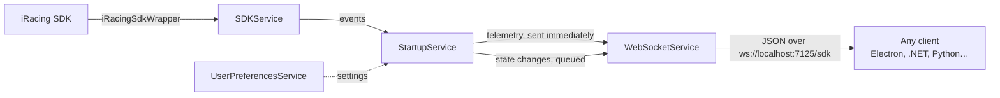

# iRacing-SDKWrapper-Service

A .NET 8 background app that reads live telemetry from the iRacing SDK and streams it to any client over a local WebSocket, so you can build iRacing tools in whatever language or framework you like.

> **Status: no longer in active development.** This service was the original backend for my [open-overlay](https://github.com/dschykerynec/open-overlay) app. Open-overlay has since moved to reading the SDK in-process to reduce latency (see [Lessons learned](#lessons-learned)). The service still works and the releases still install, but no new features are planned.

## Why this exists

Plenty of projects already wrap the iRacing SDK, but each one is tied to a single tech stack: there's a Node.js library, a Python library, and the .NET [iRacingSdkWrapper](https://github.com/NickThissen/iRacingSdkWrapper) by Nick Thissen that this project builds on. To build an Electron UI you learn one library; to build a .NET tool you learn another.

This service puts one wrapper behind a WebSocket so that any client (Electron, a .NET WinForms app, a Python script for analyzing your races) can consume the same feed. Learn one interface and use it everywhere.

## How it works



The app is an ASP.NET Core host with four services registered through dependency injection. Except for `UserPreferencesService`, they are event-driven:

- **SDKService** manages the iRacing SDK connection through iRacingSdkWrapper and raises events when telemetry updates or the sim opens and closes.
- **StartupService** subscribes to every other service and routes data between them, so the SDK and WebSocket layers never reference each other directly.
- **WebSocketService** accepts a client connection and sends each message as JSON.
- **UserPreferencesService** loads and saves `userPreferences.json` and acts as shared state for settings.

**Two features keep CPU usage down:**

- **Adaptive polling.** The service reads telemetry once per second while you're off track, then switches to your configured rate (20 Hz by default) when you get on track.
- **Event queue.** State changes such as on-track/off-track are queued and delivered when a client is connected, so a UI that connects late still learns the current state. Time-sensitive data like pedal inputs skips the queue and is sent immediately.

## Connecting a client

Connect to `ws://localhost:7125/sdk`. Every message is JSON shaped like `{ "name": "...", "value": ... }`. The service supports one client at a time; a new connection replaces the old one.

| `name` | When it's sent | `value` |
| --- | --- | --- |
| `sdk-connected` | When your client connects | Status message |
| `game-opened` | When iRacing starts | Status message |
| `game-closed` | When iRacing closes | Status message |
| `is-on-track` | When your car enters or leaves the track | `true` / `false` |
| `TelemetryDictionary` | Every telemetry tick | Throttle, brake, steering angle, speed, gear (with units), and last lap time when a lap completes |

Minimal JavaScript client:

```js
const ws = new WebSocket('ws://localhost:7125/sdk')
ws.onmessage = (event) => {
  const { name, value } = JSON.parse(event.data)
  if (name === 'TelemetryDictionary') {
    console.log(value.ThrottleInputValue, value.BrakeInputValue)
  }
}
```

## Install

Download and run `setup.exe` from the [latest release](https://github.com/dschykerynec/iRacing-SDKWrapper-Service/releases/latest). The app installs to `%LocalAppData%` and runs in the background.

To start it automatically, add it to Windows startup or launch it alongside iRacing with a tool like iRacingManager.

**Files:** user preferences and logs are stored in `%AppData%\iRacing-SDKWrapper-Service`, so updates never overwrite them. Edit `userPreferences.json` there to change the port (`PortNumber`, default `7125`) or the on-track telemetry rate (`TelemetryUpdateFrequency` in Hz, default `20`).

### Automatic updates

Installed copies update themselves with [Velopack](https://github.com/velopack/velopack). On startup the app checks the Releases page and, if a newer stable release exists, downloads it, installs it, and restarts. This step is required for installed copies: you'll see a notice while it downloads, and the app won't run if the update is cancelled. Builds you compile yourself skip the update check entirely.

## Building from source

**Requirements:** Windows, the [.NET 8 SDK](https://dotnet.microsoft.com/download/dotnet/8.0), and iRacing (the SDK only provides data while the sim is running).

The iRacingSdkWrapper DLLs aren't on NuGet and aren't committed to this repo. Download them from the [iRacingSdkWrapper repository](https://github.com/NickThissen/iRacingSdkWrapper) and place them here, next to the solution file:

```
packages/
  iRacingSdkWrapper/
    iRacingSdkWrapper.dll
    iRSDKSharp.dll
    YamlDotNet.dll
```

Then build and run:

```bash
dotnet build
dotnet run --project "iRacing SDKWrapper Service"
```

## Lessons learned

This design made the data available to any language, but every telemetry update had to be serialized to JSON, sent through a socket, and parsed again on the other side. For pedal and steering traces, even small delays make an overlay feel out of sync with the car.

In practice, the WebSocket hop made open-overlay's traces noticeably laggy, so I moved SDK reading into open-overlay's Electron main process and used in-process IPC instead. The trade-off was giving up language independence for lower latency, which was the right call for a real-time overlay. This service would still suit tools where a short delay doesn't matter, such as logging laps or analyzing races after the fact.

## License

[GPL-3.0](LICENSE). Built on [iRacingSdkWrapper](https://github.com/NickThissen/iRacingSdkWrapper) by Nick Thissen.
